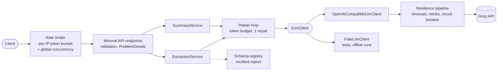

# dotnet-llm-extraction-service

[](https://github.com/cardohso/dotnet-llm-extraction-service/actions/workflows/ci.yml)
[](LICENSE)

An ASP.NET Core (.NET 10) service that wraps a large language model for two document tasks:

- **`POST /extract`** turns free text into JSON that matches a schema. The model is constrained with
  strict JSON-schema output, the service validates the result, and it retries once with the validation
  errors if the output is invalid.
- **`POST /summarise`** returns a summary plus the input sentences it is based on. Sources are
  selected by index and returned verbatim by the server, so they cannot be invented.

The model sits behind an `ILlmClient` interface. The default provider is Groq (`openai/gpt-oss-20b`)
through its OpenAI-compatible API; a deterministic fake runs the whole service and test suite offline.
On an 18-case golden set the service scored **97.8 % field accuracy with 100 % valid output** in one
real run ([details](#evaluation)).

## Architecture



| Project | Responsibility |
|---|---|
| `src/DocService.Core` | `ILlmClient`, schemas and validation, extraction and summary services, token budget. No ASP.NET dependency. |
| `src/DocService.Llm` | OpenAI-compatible HTTP client, fake client, provider selection and resilience setup. |
| `src/DocService.Api` | Minimal API endpoints, request validation, ProblemDetails mapping, rate limiting, health checks, OpenAPI. |
| `eval/DocService.Eval` | Console harness that scores the golden set against a real or fake provider. |
| `tests/*` | xUnit v3: unit tests with the fake client, integration tests with `WebApplicationFactory`, harness tests. |

## API

The responses below were captured from a local run against Groq.

### Extract

```bash
curl -s localhost:8080/extract -H 'content-type: application/json' -d '{
  "schema": "incident-report",
  "text": "On 3 March 2026 at Entroncamento depot, points machine P12 failed to detect the reverse position. Two departing services were held for 25 minutes. No injuries. Severity: medium."
}'
```

```json
{
  "schema": "incident-report",
  "data": {
    "date": "2026-03-03",
    "location": "Entroncamento depot",
    "equipment": ["points machine P12"],
    "severity": "medium",
    "summary": "On 3 March 2026 at Entroncamento depot, points machine P12 failed to detect the reverse position, holding two departing services for 25 minutes with no injuries."
  },
  "attempts": 1,
  "usage": { "inputTokens": 505, "outputTokens": 86, "estimatedCostUsd": 0 }
}
```

The `incident-report` schema has five fields: `date` (ISO date or null), `location` (string or null),
`equipment` (string array), `severity` (`low`, `medium`, `high`, `critical` or `unknown`) and
`summary` (at most 300 characters). Null and `unknown` mean "not stated in the text".

### Summarise

```bash
curl -s localhost:8080/summarise -H 'content-type: application/json' -d '{
  "text": "Train 41 stopped at the platform. The doors failed to open. Passengers waited ten minutes. A technician reset the door controller. Service resumed at 09:40.",
  "maxSentences": 2
}'
```

```json
{
  "summary": "Train 41 stopped at the platform and its doors failed to open, causing passengers to wait ten minutes. A technician reset the door controller and service resumed at 09:40.",
  "sources": [
    { "index": 1, "text": "The doors failed to open." },
    { "index": 4, "text": "Service resumed at 09:40." }
  ],
  "attempts": 2,
  "usage": { "inputTokens": 631, "outputTokens": 157, "estimatedCostUsd": 0 }
}
```

`attempts: 2` means the first reply failed validation and the repair attempt fixed it.
`maxSentences` is 1–10 (default 3).

### Errors

Every error is an RFC 9457 `application/problem+json` response with a `traceId`:

```bash
curl -s localhost:8080/extract -H 'content-type: application/json' -d '{"schema":"invoice","text":"x"}'
```

```json
{
  "type": "urn:docservice:problem:validation",
  "title": "Unknown schema",
  "status": 400,
  "detail": "unknown schema 'invoice'; available: incident-report",
  "traceId": "00-fa62f8a7e45d8c0525688ea4ce4522ba-46bde0042de9b717-00"
}
```

| Status | `type` suffix | When |
|---|---|---|
| 400 | `validation` | Blank or missing fields, malformed JSON, unknown schema, `maxSentences` out of range |
| 413 | `input-too-large` | Text over 20,000 characters, over 200 sentences for a summary, or a request body over 256 KB |
| 422 | `llm-output-invalid` | Model output still invalid after the repair attempt; `reason` is `invalid-output`, `output-truncated` or `budget-exhausted`, plus an `errors` list |
| 429 | `rate-limited` | This service's rate limiter rejected the request (`Retry-After` set) |
| 502 | `provider-error` | The provider returned an error after retries (including a rejected API key) |
| 503 | `provider-unavailable` | Circuit breaker open, provider unreachable, or provider rate limit (`Retry-After` passed on) |
| 504 | `provider-timeout` | The provider call timed out |

### Health and docs

- `GET /health/live`: the process is running.
- `GET /health/ready`: unhealthy while the provider circuit breaker is open. It never calls the model, so it does not use quota.
- `GET /openapi/v1.json`: OpenAPI document. Swagger UI is at `/swagger` in Development.

## Design decisions

- **Structured output plus server-side validation.** Strict JSON-schema mode makes invalid JSON rare,
  but it does not enforce business rules. The service deserialises strictly (unknown fields rejected,
  nullability respected) and then checks semantics: the date is not in the future, items are unique,
  lengths are within limits.
- **One repair attempt, not blind retries.** The repair prompt contains the previous output and the
  exact validation errors. A truncated reply (`finish_reason = length`) is not repaired, because the
  same output cap would cut it off again.
- **Token budget per request.** Input over 20,000 characters is rejected before any model call. Each
  request has a 16,000-token budget across attempts; if the first attempt leaves too little for a
  repair, the service returns 422 instead of spending more.
- **Two layers of retry with different jobs.** `Microsoft.Extensions.Http.Resilience` handles transport
  failures: 30 s total and 10 s per-attempt timeouts, 2 retries with jitter that honour `Retry-After`,
  and a circuit breaker. 400, 401 and 403 are never retried. The repair loop handles content failures.
- **Grounded summaries by index.** The server numbers the sentences, the model returns indices, and the
  server returns the original text. Out-of-range or duplicate indices trigger the repair attempt.
- **Provider abstraction kept small.** `ILlmClient` has one method. The OpenAI-compatible client works
  with any compatible endpoint by changing `Llm:BaseUrl` and `Llm:Model`; the fake client scripts
  replies and failures for tests and can run the service with no key.
- **Fail fast on configuration.** Options are validated at startup. A missing API key stops the service
  with `Llm:ApiKey is not set. Use dotnet user-secrets or the Llm__ApiKey environment variable.` and exit code 1.
- **Privacy in logs.** Logs are structured JSON. They record text length and a 12-character SHA-256
  prefix, never the input text; a test checks this.
- **Prompt-injection hygiene.** Prompts tell the model to treat the document as data. Output is only
  ever parsed against a schema, never executed or used to call tools.

## Evaluation

`eval/DocService.Eval` runs the 18-case golden set in
[`eval/golden/incident-reports.jsonl`](eval/golden/incident-reports.jsonl) through the real extraction
service and scores each field. The thresholds and scoring rules in
[`eval/THRESHOLDS.md`](eval/THRESHOLDS.md) were committed before the first real run and not changed
afterwards.

**Run on 2026-10-31, Groq `openai/gpt-oss-20b`, free-tier key, 18 cases, one run**
([full report](eval/results/2026-10-31-0258-groq.md)):

| Metric | Result | Threshold |
|---|---|---|
| Valid output after repair | 100.0 % | ≥ 95 % ✅ |
| Overall field accuracy | 97.8 % | ≥ 85 % ✅ |
| Severity accuracy | 100.0 % | ≥ 80 % ✅ |
| p95 latency | 1,028 ms | ≤ 5,000 ms ✅ |

| Field | Score |
|---|---|
| date | 100.0 % |
| location | 100.0 % |
| equipment (set F1) | 91.2 % |
| severity | 100.0 % |
| valid on first attempt | 100.0 % |
| latency p50 / p95 | 334 ms / 1,028 ms |

All 18 replies were valid on the first attempt; total usage was 11,997 tokens. Equipment was the only
imperfect field: 7 cases scored below 1.0 (lowest 0.67).

**How to read this.** The cases are synthetic texts written for this repository: real place names,
fictional events. They include relative dates that must stay null, dates without a year, distracting
earlier dates, uninvolved equipment, three Portuguese texts and two long reports. The same author wrote
the cases and the prompt rules, and the prompt was aligned with the gold definitions before the run.
This is a regression check for this service, not an independent benchmark, and 18 cases from one run
cannot separate small differences.

Re-run it:

```bash
dotnet run --project eval/DocService.Eval -- --provider groq   # needs the API key, see below
dotnet run --project eval/DocService.Eval -- --provider fake   # offline smoke run, as in CI
```

Reports are written to `eval/results/`. The exit code is 1 if any threshold is missed. In GitHub
Actions the real run is a manual workflow (`eval.yml`) that uses the `GROQ_API_KEY` repository secret.

## Limitations

- **One schema.** Only `incident-report` exists. Adding one means a record, a JSON schema and a
  validator registered in DI.
- **Small, author-written golden set.** See [Evaluation](#evaluation).
- **Lenient matching.** Location and equipment count as correct when one string contains the other
  on word boundaries, so a vaguer answer ("Lisboa" for "Lisboa Oriente") can get credit.
- **Equipment misses are not itemised.** The report shows per-case F1 but does not store predictions,
  so it does not say which items were missed.
- **Summary attribution is checked for validity, not completeness.** The example above cites sentences
  1 and 4, but the summary also uses sentences 0, 2 and 3. Sources are always verbatim and in range;
  they may be incomplete, and attribution is not evaluated.
- **Regex sentence splitter.** It handles common abbreviations but can split badly on unusual punctuation.
- **Approximate pre-call token estimate** (characters ÷ 4). Actual usage from the provider is used after each call.
- **No authentication.** Rate limiting protects a free quota, but the service is not meant for public
  deployment as it is.
- **Per-IP limits assume direct connections.** There is no forwarded-headers handling, so behind a proxy
  or load balancer every client shares one rate-limit bucket.
- **Gemini and other providers are untested.** They should work by configuration (see below) but were
  not run.

## Run locally

Requirements: the [.NET 10 SDK](https://dotnet.microsoft.com/download). For the container: Docker
(Docker Desktop, or Colima with the `docker` CLI).

```bash
git clone https://github.com/cardohso/dotnet-llm-extraction-service.git
cd dotnet-llm-extraction-service
```

**Tests** (offline, no key needed):

```bash
dotnet test --solution dotnet-llm-extraction-service.slnx
```

**Run with the fake provider** (no key; returns fixed, schema-valid replies):

```bash
Llm__Provider=Fake dotnet run --project src/DocService.Api --urls http://localhost:8080
```

Then try `curl -s localhost:8080/health/ready` or the requests in [API](#api).

**Run with Groq.** Create a free key at console.groq.com, then store it with .NET user-secrets, which
keep it outside the repository:

```bash
dotnet user-secrets set "Llm:ApiKey" "<your key>" --project src/DocService.Api
```

```bash
ASPNETCORE_ENVIRONMENT=Development dotnet run --project src/DocService.Api --urls http://localhost:8080
```

User-secrets are only loaded in the Development environment. Elsewhere, set the `Llm__ApiKey`
environment variable instead; [`.env.example`](.env.example) lists the variables.

**Docker:**

```bash
docker build -t docservice .
docker run --rm -p 8080:8080 -e Llm__Provider=Fake docservice
```

For Groq, replace `-e Llm__Provider=Fake` with `-e Llm__ApiKey=<your key>`. The image is multi-stage,
runs as a non-root user and has a `HEALTHCHECK` on `/health/live`.

### Configuration

Settings live in `src/DocService.Api/appsettings.json`. Any of them can be overridden with environment
variables using `__` for nesting, for example `Processing__MaxInputChars=10000`.

| Setting | Default | Meaning |
|---|---|---|
| `Llm:Provider` | `OpenAiCompatible` | `OpenAiCompatible` or `Fake` |
| `Llm:BaseUrl` | `https://api.groq.com/openai/v1/` | Any OpenAI-compatible endpoint, ending in `/` |
| `Llm:Model` | `openai/gpt-oss-20b` | Model name sent to the provider |
| `Llm:ReasoningEffort` | `low` | Sent as `reasoning_effort`; set it empty to omit it |
| `Llm:Pricing:*PerMillionUsd` | `0` | Used for `estimatedCostUsd` |
| `Llm:Resilience:*` | see file | Timeouts, retries, circuit breaker |
| `Processing:*` | see file | Input limit, token budget, output token caps |
| `Kestrel:Limits:MaxRequestBodySize` | `262144` | Request body limit in bytes, enforced before the body is read |
| `RateLimiting:*` | 5 burst, 1 token / 3 s per IP; 4 concurrent, queue 10 | Request limits |

For Gemini's OpenAI-compatible endpoint (untested), set `Llm:BaseUrl` to
`https://generativelanguage.googleapis.com/v1beta/openai/`, `Llm:Model` to a Gemini model name and
`Llm:ReasoningEffort` to empty if the endpoint rejects it.

## Quality checks

CI ([`ci.yml`](.github/workflows/ci.yml)) runs on every push and pull request: `dotnet format
--verify-no-changes`, a Release build with warnings as errors and nullable reference types on, the full
test suite (156 tests, no network), and the evaluation harness against the fake provider.

## Licence

[MIT](LICENSE)
